<h1 align="center">sayn</h1>
<p align="center"><b>Subscriptions Are All You Need.</b><br>

See an app you like, click <b>Make my own</b>, and five minutes later your own version is on your phone. No ads, no paywall, no app store. Free, open source, runs on your laptop.</p>

<p align="center"></p>

Found a habit tracker that wants $6.99 a month? A flashlight with three ad banners? A to-do app
that almost fits but not quite? Pick it in sayn, write one line about what you want different,
and your coding agent builds your own version and installs it on the phone plugged into your
laptop. Don't need a template? Just describe the app in a sentence.

---

sayn costs nothing and has no accounts. It uses the coding agent you already have, Claude Code or
Codex CLI, billed to the Claude or ChatGPT plan you already pay for. sayn is the factory around it:

- **Describe it.** One paragraph in a local dashboard. Codex CLI or Claude Code writes a real Expo /
  React Native app, your laptop compiles a signed release APK, adb installs and launches it on the
  phone on your desk. About 5 minutes.
- **Or search the Play Store and make your own.** Browse the top charts or search any app, pick it,
  add your notes. The agent builds your version from the store listing, screenshots and reviews. Tick
  one box and [REA](https://github.com/morluto/rea) analyses the real APK into a feature spec
  (screens, flows, data) that the agent builds from. It never copies the original's code. No ads, no in-app purchases, no
  subscription, and it is yours. Names, branding, assets and code are never copied.
- **Change it any time.** Every app has a text box for the next change. The agent edits the code, the
  version bumps, the app rebuilds and reinstalls. Each run is a git commit inside the app folder.

Everything runs on your machine. No cloud sandbox, no account, no API key, no per-app cost. The only
thing that leaves your laptop is the conversation your agent already has with its provider.

## Quick start

You need a Windows or Linux x64 machine, [Node 20+](https://nodejs.org), an Android phone with USB
debugging on, and at least one coding agent signed in:

```bash
npm i -g @openai/codex && codex login                      # Codex CLI (ChatGPT plan)
npm i -g @anthropic-ai/claude-code && claude auth login     # and/or Claude Code (Claude plan)
```

The setup script installs the rest per-user, without admin rights: JDK 17, the Android SDK, `uv` +
Python 3.12, npm dependencies, a release keystore and the JADX jar REA uses. Re-run it any time.

**Windows**

```powershell
git clone https://github.com/Ersho/sayn.git
cd sayn
powershell -ExecutionPolicy Bypass -File scripts\setup.ps1     # or double-click scripts\setup.bat
scripts\dev.ps1                                               # in a new terminal; or scripts\dev.bat
```

Windows needs long paths enabled once; the script prints the exact admin command if they are not.

**Linux**

```bash
git clone https://github.com/Ersho/sayn.git
cd sayn
bash scripts/setup.sh
bash scripts/dev.sh
```

If `adb devices` does not list your phone, install the udev rules (`android-sdk-platform-tools-common`
on Debian/Ubuntu) and replug it.

Then open <http://localhost:5173>, plug in the phone, accept the USB debugging prompt on it, and
create your first app. The very first build downloads Gradle and compiles the native code (about
10 minutes); after that an app takes 5 to 7 minutes end to end, most of it in Gradle.

## How it works

```
 dashboard (Vite + React)  ──HTTP/SSE──▶  backend (FastAPI)
                                              │
            1. copy template/ → ~/vibeapping/apps/<id>   (Expo SDK 58, expo-router, TypeScript)
            2. codex exec  |  claude -p      with the create / revise / fix prompt
            3. tsc → expo prebuild → gradlew assembleRelease   (agent fixes build errors, up to 5 rounds)
            4. adb install -r → launch → screenshot
```

Builds are release builds signed with a keystore generated once on your machine, so apps stay
installed, update in place and look like any other app. They all get the launcher label `my:<name>`,
so typing `my:` in the phone's app search lists everything sayn made. Each app is a normal Expo
project and a normal git repository: open it in any editor or keep iterating from the dashboard.

## Configuration

| What | Where |
|---|---|
| Generated apps, keystore, config, caches | `~/vibeapping/` (`%USERPROFILE%\vibeapping` on Windows) |
| Codex model | `VIBE_CODEX_MODEL` (default `gpt-5.6-sol`; the Codex config default is not available on ChatGPT plans) |
| Claude model | `VIBE_CLAUDE_MODEL` (default: the CLI's own default) |
| API keys for generated apps | Settings tab, stored in `~/vibeapping/keys.json`, passed to apps as `EXPO_PUBLIC_*` |

Prompts live in `backend/vibe/codex.py` and are shared by both agents. `template/AGENTS.md` is what
the agent reads inside every generated app. [AGENTS.md](AGENTS.md) is the detailed guide to this code
base: request flow, exact agent invocations, pinned versions and the Windows pitfalls.

## Built on

[Expo](https://expo.dev) · [Codex CLI](https://github.com/openai/codex) · [Claude Code](https://github.com/anthropics/claude-code) ·
[REA](https://github.com/morluto/rea) + [jadx-headless-mcp](https://github.com/1013503897/jadx-headless-mcp) ·
[google-play-scraper](https://github.com/facundoolano/google-play-scraper) · [adbutils](https://github.com/openatx/adbutils) · FastAPI · Vite

## License

MIT, see [LICENSE](LICENSE).
